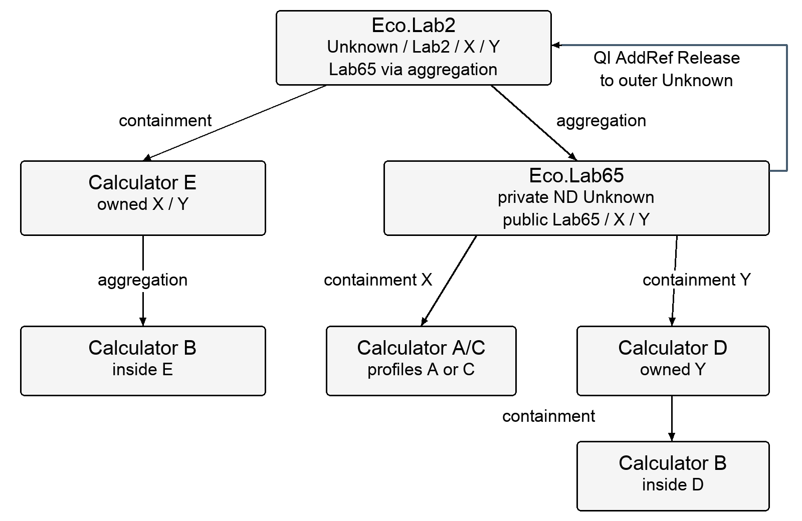
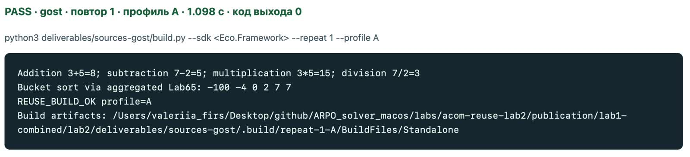

# Software Architecture Lab 2 — ACOM Containment and Aggregation

Лабораторная работа 2 по архитектуре программного обеспечения. Компонент **Bucket sort из первой работы** расширен арифметическими интерфейсами; новый **Eco.Lab2** объединяет его с учебными калькуляторами через включение и агрегирование ACOM.

**Автор:** Фирсова Валерия Дмитриевна. **Группа:** 24ТИДИ.

**[Итоговый сравнительный отчёт Word](deliverables/report-comparison.docx)** · **[Аудит архитектуры и оформления](docs/audit-20261024/audit.md)** · **[Таблица измерений](deliverables/generation-measurements.csv)**

## Что реализовано

- Eco.Lab65 сохраняет пять методов распределительной сортировки из первой работы, включает X калькулятора A либо C и Y калькулятора D.
- Eco.Lab2 включает один E, получает оба его интерфейса и агрегирует настоящий Eco.Lab65.
- D включает B; E агрегирует B. Компоненты преподавателя взяты из `001.InsideACOM`.
- Все публичные интерфейсы одного объекта доступны друг из друга через QueryInterface: матрицы **4×4 для Lab65** и **5×5 для Lab2**. Они имеют единый канонический IEcoUnknown.
- Публичные интерфейсы агрегата делегируют QueryInterface/AddRef/Release внешнему контроллеру. Его отдельный приватный Unknown управляет внутренним временем жизни.



A и C имеют одинаковый CID в исходной учебной поставке, поэтому демонстрируются **в отдельных профилях A/C**. Оба профиля также используют B, D и E.

## Реализации и статусы

Локальная **Qwen2.5-Coder-14B-Instruct-4bit через MLX и обёртку ARPO** создавала `Reuse.c` и исправления. Организатор подготовил контракт, исходный незавершённый шаблон, независимые проверки, измерения и отчёт. Численный файл первой лабораторной сохранён побайтно. Файл `Reuse.c` в общем каталоге намеренно отсутствует: его заменяет выбранный итоговый файл модели из `variants/repeat-N`.

| Подход | Повтор | Seed | Исходник | Приёмка A/C | Расширенный аудит A/C |
|---|---:|---:|---|---|---|
| вариант с кратким промптом | 1 | 42 | [Reuse.c](deliverables/sources-short/variants/repeat-1/Reuse.c) | passed | passed |
| вариант с кратким промптом | 2 | 43 | [Reuse.c](deliverables/sources-short/variants/repeat-2/Reuse.c) | passed | passed |
| вариант с кратким промптом | 3 | 44 | [Reuse.c](deliverables/sources-short/variants/repeat-3/Reuse.c) | passed | passed |
| вариант с подробным промптом — ТЗ по ГОСТ | 1 | 42 | [Reuse.c](deliverables/sources-gost/variants/repeat-1/Reuse.c) | passed | passed |
| вариант с подробным промптом — ТЗ по ГОСТ | 2 | 43 | [Reuse.c](deliverables/sources-gost/variants/repeat-2/Reuse.c) | passed | passed |
| вариант с подробным промптом — ТЗ по ГОСТ | 3 | 44 | [Reuse.c](deliverables/sources-gost/variants/repeat-3/Reuse.c) | passed | passed |
| контроль с обычным длинным промптом | 1 | 42 | [Reuse.c](deliverables/sources-ordinary-control/variants/repeat-1/Reuse.c) | passed | passed |
| контроль с обычным длинным промптом | 2 | 43 | [Reuse.c](deliverables/sources-ordinary-control/variants/repeat-2/Reuse.c) | passed | passed |
| контроль с обычным длинным промптом | 3 | 44 | [Reuse.c](deliverables/sources-ordinary-control/variants/repeat-3/Reuse.c) | passed | passed |

Все девять первых ответов модели не прошли обязательную сборку. В таблице указаны **финальные исправленные версии**, а не успех с одного запроса. Промежуточные ответы, уточнения, статусы и сводки запросов сохранены внутри `provenance/history` и `prompts/followups` каждого варианта. Недействительная предварительная серия описана в [сводке расходов](docs/evidence/invalid-pilot-summary.json) и [разборе ошибки тестового окружения](docs/evidence/oracle-correction.json).

## Где проверять части работы

Общие файлы ниже одинаковы во всех повторах соответствующих вариантов.

| Часть | Вариант с кратким промптом | Вариант с подробным промптом |
|---|---|---|
| Алгоритм Bucket sort | [BucketMethods.c](deliverables/sources-short/common/SourceFiles/BucketMethods.c) | [BucketMethods.c](deliverables/sources-gost/common/SourceFiles/BucketMethods.c) |
| Контракт и владение | [ReuseContract.h](deliverables/sources-short/common/HeaderFiles/ReuseContract.h) | [ReuseContract.h](deliverables/sources-gost/common/HeaderFiles/ReuseContract.h) |
| ABI численных методов | [ArpoMethods.h](deliverables/sources-short/common/HeaderFiles/ArpoMethods.h) | [ArpoMethods.h](deliverables/sources-gost/common/HeaderFiles/ArpoMethods.h) |
| Интерфейс сортировки | [IEcoLab65.h](deliverables/sources-short/common/SharedFiles/IEcoLab65.h) | [IEcoLab65.h](deliverables/sources-gost/common/SharedFiles/IEcoLab65.h) |
| Интерфейс внешнего объекта | [IEcoLab2.h](deliverables/sources-short/common/SharedFiles/IEcoLab2.h) | [IEcoLab2.h](deliverables/sources-gost/common/SharedFiles/IEcoLab2.h) |
| Каркас и методы объектов | [Reuse.c, повтор 1](deliverables/sources-short/variants/repeat-1/Reuse.c) | [Reuse.c, повтор 1](deliverables/sources-gost/variants/repeat-1/Reuse.c) |
| Фабрика Lab65 | [CEcoLab65Factory.c](deliverables/sources-short/common/SourceFiles/CEcoLab65Factory.c) | [CEcoLab65Factory.c](deliverables/sources-gost/common/SourceFiles/CEcoLab65Factory.c) |
| Фабрика Lab2 | [CEcoLab2Factory.c](deliverables/sources-short/common/SourceFiles/CEcoLab2Factory.c) | [CEcoLab2Factory.c](deliverables/sources-gost/common/SourceFiles/CEcoLab2Factory.c) |
| Клиент EcoMain | [EcoLab2.c](deliverables/sources-short/common/UnitTestFiles/SourceFiles/EcoLab2.c) | [EcoLab2.c](deliverables/sources-gost/common/UnitTestFiles/SourceFiles/EcoLab2.c) |
| Независимые проверки | [acom.c](deliverables/sources-short/checks/acom.c) | [acom.c](deliverables/sources-gost/checks/acom.c) |
| Самостоятельная сборка | [build.py](deliverables/sources-short/build.py) | [build.py](deliverables/sources-gost/build.py) |

Контрольный обычный длинный вариант имеет [тот же полный комплект файлов](deliverables/sources-ordinary-control/README.md). В каждом каталоге `builds/macos-arm64` находятся три статические сборки компонента без приватных библиотек SDK.

## Сборка и запуск

Нужны **macOS Apple Silicon**, Apple Command Line Tools и **Python 3.9 или новее**. Отдельно получите у преподавателя **Eco.Framework из Eco.Framework_20260918.zip**. Скрипт проверяет хеши используемых файлов SDK. Для сборки не нужны модель, MLX, Python-пакеты солвера или сеть.

```sh
python3 deliverables/sources-short/build.py --sdk "/absolute/path/Eco.Framework" --repeat 1 --profile A
python3 deliverables/sources-short/build.py --sdk "/absolute/path/Eco.Framework" --repeat 1 --profile A --check
python3 deliverables/sources-short/build.py --sdk "/absolute/path/Eco.Framework" --repeat 1 --profile C --check
```

Для подробного варианта замените `sources-short` на `sources-gost`, для контроля — на `sources-ordinary-control`. Флаг `--repeat` выбирает повтор 1, 2 или 3. Первая команда запускает демонстрацию арифметики и сортировки; `--check` — независимый клиент с UBSan. Исполняемый файл появляется в `.build/repeat-N-PROFILE/BuildFiles/Standalone/client` внутри выбранного комплекта.

Все варианты, повторы и профили, включая дополнительный аудит:

```sh
python3 tools/run_checks.py --sdk "/absolute/path/Eco.Framework" --all --extended
```

Один вариант с расширенной проверкой:

```sh
python3 tools/run_checks.py --sdk "/absolute/path/Eco.Framework" --variant gost --repeat 2 --profile A --extended
```

Исходная приёмка выполняет **28 936 утверждений на профиль**. Аудит от 24.10.2026 добавляет **10 500**, итого **39 436**, и проверяет удержание каждого публичного интерфейса, внешний контроллер, отдельные экземпляры и отсутствие необязательного MemExt. Это количество утверждений, включая сравнения элементов, а не количество разных сценариев. Дополнительные проверки проведены после эксперимента и не меняют его исторические измерения.

Клиент входит через EcoMain, стандартную main предоставляет Eco.System1. Фабрики зарегистрированы в реальной IEcoInterfaceBus1. Компонент использует IEcoMemoryAllocator1; libc разрешена независимым тестовым и измерительным клиентам.

## Промпты и результаты

- [Краткий промпт](experiment/short.txt).
- [Подробный промпт — ТЗ по структуре ГОСТ 19.201-78](experiment/detailed.txt).
- [Обычный длинный контрольный промпт](experiment/ordinary-long.txt).
- [Постановка эксперимента](experiment/task.md) и [исходный незавершённый Reuse.c](experiment/initial-Reuse.c).
- [Полные измерения генерации](deliverables/generation-measurements.csv), [первый ответ каждого запуска](deliverables/generation-initial-phase.csv).
- [Замеры арифметики и QI](deliverables/benchmarks-calls.csv), [сортировка и qsort](deliverables/benchmarks-sort.csv); рядом сохранены исходные `*-raw.csv`.

Медианы трёх повторов включают неудачи и продолжения до приёмки:

| Подход | Итог | Известные токены | API-попытки | Известное активное время, мин |
|---|---:|---:|---:|---:|
| Краткий | 3/3 | ≥ 237 721 | 15 | 82.46 |
| ТЗ по ГОСТ | 3/3 | 263 723 | 15 | 76.36 |
| Обычный длинный | 3/3 | ≥ 275 732 | ≥ 16 | ≥ 87.96 |

Знак ≥ означает нижнюю границу из-за неполных данных прерванных обращений. Это время получения проверенного решения, а не скорость сортировки; труд организатора и написание отчёта в него не включены. Локальный тариф токенов — 0 USD; энергопотребление не измерялось.

ТЗ и обычный длинный промпт содержат одинаковые 19 содержательных абзацев; оформление ТЗ добавляет 222 токена к начальному контексту. Три повтора и адаптивные исправления не доказывают самостоятельное причинное преимущество ГОСТ.

<!-- BEGIN VERIFIED BENCHMARK TABLES -->
## Скорость выполнения и baseline

В PDF «Задание 2» (с. 1–4) нет отдельного требования измерять скорость или выбирать baseline. Требуются включение/агрегирование, переходы QueryInterface, исходники, сборка, UnitTest и Word-описание. Таблицы ниже дополняют эту проверку; baseline выбран в нашей методике.

Это **сохранённые измерения из отчёта**, сверенные с 1 080 исходными строками замеров, а не значения времени из скринкаста. Время в строке PASS видео включает сборку и запуск клиента.

### Сортировка: baseline — стандартная C `qsort`

Тип `double`, 128 блоков, одинаковые копии входа, поэлементная проверка точного совпадения. Показаны два характерных размера из полного набора; [все 36 строк](deliverables/benchmarks-sort.csv) и [540 исходных замеров](deliverables/benchmarks-sort-raw.csv) доступны отдельно. Меньшее время лучше. Отношение — медиана времени qsort / медиана времени Bucket sort: значение > 1 означает преимущество Bucket sort, < 1 — преимущество qsort.

| Промпт | Профиль | Вход и N | Bucket sort, мс | Baseline qsort, мс | qsort / Bucket |
| --- | --- | --- | ---: | ---: | ---: |
| Краткий | A | Равномерный, 50 000 | 1.819 | 3.089 | 1.698 |
| Краткий | A | Обратный в одном блоке, 10 000 | 12.430 | 0.126 | 0.010 |
| Краткий | C | Равномерный, 50 000 | 2.834 | 4.844 | 1.709 |
| Краткий | C | Обратный в одном блоке, 10 000 | 12.568 | 0.152 | 0.012 |
| ТЗ по ГОСТ | A | Равномерный, 50 000 | 1.807 | 3.169 | 1.754 |
| ТЗ по ГОСТ | A | Обратный в одном блоке, 10 000 | 12.446 | 0.133 | 0.011 |
| ТЗ по ГОСТ | C | Равномерный, 50 000 | 2.776 | 4.602 | 1.658 |
| ТЗ по ГОСТ | C | Обратный в одном блоке, 10 000 | 12.561 | 0.139 | 0.011 |
| Обычный длинный | A | Равномерный, 50 000 | 2.532 | 4.428 | 1.749 |
| Обычный длинный | A | Обратный в одном блоке, 10 000 | 12.218 | 0.125 | 0.010 |
| Обычный длинный | C | Равномерный, 50 000 | 2.788 | 4.719 | 1.693 |
| Обычный длинный | C | Обратный в одном блоке, 10 000 | 12.291 | 0.126 | 0.010 |

Во всех вариантах второй работы численный файл сортировки одинаков и взят из первой работы. Различия времени между строками не означают разные численные алгоритмы. При концентрации обратного массива в одном блоке сортировка вставками даёт квадратичный случай: на N=10 000 здесь Bucket sort примерно в 83–99 раз медленнее qsort.

### Вызовы ACOM: baseline — прямое обращение к E

`direct_E` — X/Y компонента E без внешних обёрток лабораторной. Сам E уже агрегирует B: это baseline выбранного маршрута, а не чистая арифметика C и не компонент без агрегирования. E предоставляет X и Y для всех четырёх операций; у B есть только X. Baseline измерялся заново в каждой ветке и профиле.

| Промпт | Профиль | Маршрут | Арифметика, нс/вызов | QI(X) + Release, нс/пара |
| --- | --- | --- | ---: | ---: |
| Краткий | A | **E — baseline** | 0.880 | 9.186 |
| Краткий | A | Eco.Lab65, включение | 1.053 | 6.318 |
| Краткий | A | Eco.Lab2 с агрегатом | 0.866 | 3.686 |
| Краткий | C | **E — baseline** | 0.957 | 10.246 |
| Краткий | C | Eco.Lab65, включение | 1.246 | 5.618 |
| Краткий | C | Eco.Lab2 с агрегатом | 0.814 | 3.438 |
| ТЗ по ГОСТ | A | **E — baseline** | 0.957 | 11.568 |
| ТЗ по ГОСТ | A | Eco.Lab65, включение | 0.985 | 5.966 |
| ТЗ по ГОСТ | A | Eco.Lab2 с агрегатом | 0.864 | 4.046 |
| ТЗ по ГОСТ | C | **E — baseline** | 0.847 | 8.126 |
| ТЗ по ГОСТ | C | Eco.Lab65, включение | 1.119 | 5.040 |
| ТЗ по ГОСТ | C | Eco.Lab2 с агрегатом | 0.809 | 3.316 |
| Обычный длинный | A | **E — baseline** | 1.011 | 10.676 |
| Обычный длинный | A | Eco.Lab65, включение | 0.999 | 5.492 |
| Обычный длинный | A | Eco.Lab2 с агрегатом | 0.866 | 3.800 |
| Обычный длинный | C | **E — baseline** | 1.015 | 10.340 |
| Обычный длинный | C | Eco.Lab65, включение | 1.285 | 5.664 |
| Обычный длинный | C | Eco.Lab2 с агрегатом | 0.848 | 3.276 |

Каждая ячейка — медиана 15 замеров (3 реализации × 5 повторов). Арифметический замер содержит 500 000 итераций по четыре операции, то есть 2 000 000 вызовов; вторая метрика — 500 000 пар QueryInterface(X) + Release. Проверяется контрольная сумма. Сборка — `-O2` без санитайзера; таймер — `clock()`, процессорное время процесса. Сервер MLX был остановлен перед историческими измерениями.

Наносекунды получены делением времени большого цикла, а не измерением отдельного вызова. Маршруты используют разные реализации QI и зависимости, поэтому меньшее число у Lab2 не доказывает, что агрегирование само по себе ускоряет вызовы. Влияние прогрева, кэша, разрешения таймера и состояния одного Mac не исключено. Проверена macOS arm64; результаты не являются общей гарантией производительности.

[Полный протокол](deliverables/sources-gost/provenance/benchmark-protocol.json) · [Сводка вызовов](deliverables/benchmarks-calls.csv) · [Исходные замеры вызовов](deliverables/benchmarks-calls-raw.csv)
<!-- END VERIFIED BENCHMARK TABLES -->

## Проверки и ограничения

После переноса в общий репозиторий [все 18 конфигураций проверены заново](docs/integration-20261025/summary.md), первая лабораторная также прошла все шесть проверок.

- [Последний аудит и оговорки](docs/audit-20261024/audit.md), [его итог](docs/audit-20261024/result.json), [результаты 18 конфигураций](docs/audit-20261024/execution.json).
- [Ручная проверка девяти решений](docs/evidence/manual-review.json), [проверка переносимых архивов](docs/evidence/package-verification.json), [целостность происхождения](docs/audit-20261024/integrity.json).
- [Итоговая сверка отчёта, метрик и исходников](deliverables/final-audit.json).

Проверки конечны и выполнены на macOS arm64. Не проверены все глубокие отказы внутри старых компонентов поставщика, другие ОС, многопоточность и межпроцессная маршализация. Дефект identity исходных C/D изолирован собственными публичными обёртками лабораторной. Полная поведенческая приёмка Lab2 первоначально выполнялась после генерации. Часть затрат прерванных запросов не восстановлена; она раскрыта в отчёте.

В протоколах сохранены пути исходного компьютера и исторические ссылки на локальные журналы/рендеры. Они не являются зависимостями сборки. Полные HTTP-журналы и прежняя недействительная серия сохранены локально; в публичный комплект вошли сводки, история исходников и уточнения. Исходные PDF преподавателя, SDK, веса и окружение ARPO в репозиторий не включены.

Отдельные неизменённые ZIP-комплекты: [краткий](deliverables/sources-short.zip), [подробный](deliverables/sources-gost.zip), [обычный длинный](deliverables/sources-ordinary-control.zip).

## Локальная демонстрация и скринкаст

Из корня общего репозитория:

```sh
python3 lab2/tools/serve_demo.py --sdk "/absolute/path/Eco.Framework"
```

Откройте **http://127.0.0.1:8765**. Если запускаете из самой папки `lab2`, уберите
`lab2/` из пути команды. Сервер использует стандартную библиотеку Python и работает
только на этом компьютере. Остановка — Ctrl+C. Свободный порт можно выбрать через `--port`.

Для записи экрана:

1. Покажите автора, группу, выбранный промпт, повтор и профиль A.
2. Нажмите «Арифметика и сортировка»: должны появиться результаты 8, 5, 15, 3 и массив `-100 -4 0 2 7 7`.
3. Нажмите «Проверить ACOM»: покажите фактическую строку `EXTENDED_ACOM cases=39436 extra=10500 failures=0 mock_live=0 environment_refs=1 memory_refs=1`.
4. Повторите для профиля C и покажите схему компонентов. При необходимости выберите другие промпты/повторы.

На странице выводится результат настоящих нативных процессов, включая код выхода и
время конкретного запуска. Это демонстрация после эксперимента; её время не добавляется
к историческим затратам Qwen. При нажатии кнопок выполняется новая сборка. Для скринкаста
достаточно выбранного варианта; полную матрицу повторов проверяет `tools/run_checks.py --all --extended`.

[Снимок полной страницы с расширенной проверкой ACOM](docs/figures/local-demo.png)

### Запись запуска

[](docs/media/lab2-console-demo.mp4)

**[Смотреть или скачать MP4 — 32 секунды, 1600×366](docs/media/lab2-console-demo.mp4).**
В кадре оставлены строка результата с временем, команда и консольный вывод. Панели браузера,
вкладки, остальная страница и пустые ожидания вырезаны. Сохранённые фрагменты идут с исходной
скоростью; результаты и показанные числа не изменены. Параметры обработки и SHA256 находятся
в [протоколе монтажа](docs/media/editing-receipt.json).

**Цифры в строке PASS — полное время сборки и демонстрационного запуска.** Они не являются
временем одной сортировки или задержкой вызова ACOM. Запись показывает арифметику и сортировку для трёх подходов: повтор 1 / профиль A и повтор 3 / профиль C;
независимые проверки всех 18 конфигураций ACOM подтверждаются отдельными журналами. Для сравнения производительности
используются [таблицы с baseline](#скорость-выполнения-и-baseline) выше, рассчитанные по сохранённым замерам.

## Источники

Первая лабораторная: [Bucket sort](https://github.com/Dorila24/-software-architecture_lab1_bucket-sort). Калькуляторы: [Eco.Education](https://github.com/peerf-eco/Eco.Education/tree/7f1664b0489bcea6d5b211807ea5cb0ce0e1068e/Eco.Pro.Training/001.InsideACOM). Обёртка: [ARPO_solver_macos](https://github.com/Dezmant8/ARPO_solver_macos/tree/703b25815adfe0c75471a7b9ffb67b3eb980c44c). Происхождение и авторские уведомления описаны в [THIRD_PARTY_NOTICES.md](THIRD_PARTY_NOTICES.md).
