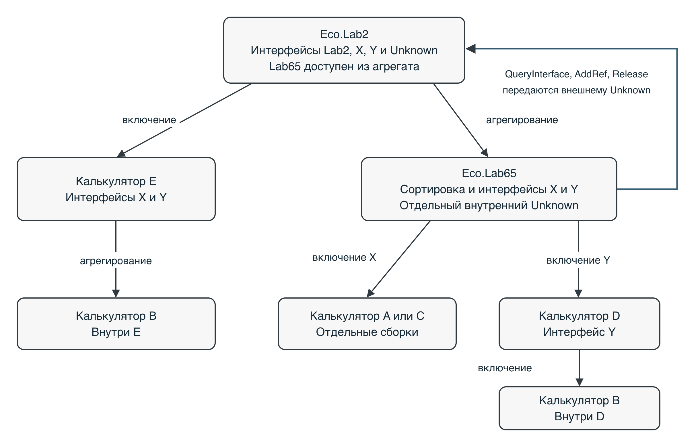

# Лабораторная работа 2 — включение и агрегирование ACOM

**Выполнила:** Фирсова Валерия Дмитриевна · **Группа:** 24ТИДИ

Вторая работа продолжает первую: к компоненту блочной сортировки добавлены калькуляторы и новый компонент Eco.Lab2. Сортировка осталась прежней. Новая часть отвечает за связь объектов, переходы между их интерфейсами и правильное освобождение памяти.

**[Отчёт Word](deliverables/report-comparison.docx)** · **[Запись запуска](#видео)** · **[Замеры скорости](#скорость-выполнения)** · **[Исходники](#исходники-и-файлы-для-проверки)**

## Что сделано

Eco.Lab65 — это компонент первой работы. Он сортирует массивы и теперь предоставляет четыре арифметические операции через включённые калькуляторы. Новый Eco.Lab2 объединяет его с компонентом E.

Здесь используются два способа связи:

- **Включение.** Внешний объект хранит ссылку на калькулятор и передаёт ему вызовы через свои методы. Так Lab65 использует A либо C и компонент D, а Lab2 — один экземпляр E.
- **Агрегирование.** Внешний объект выдаёт клиенту настоящий интерфейс внутреннего компонента, но сам управляет общими ссылками. Так Lab2 предоставляет сортировку из Lab65.

Внутри учебных калькуляторов тоже есть связи: D включает B, а E агрегирует B. Таким образом, задействованы все компоненты A–E. A и C имеют одинаковый идентификатор в учебной поставке, поэтому проверяются в двух отдельных вариантах сборки — A и C.



Метод `QueryInterface` позволяет получить другой интерфейс объекта. Проверены переходы **из каждого интерфейса в каждый**: 4×4 у самостоятельного Lab65 и 5×5 у Lab2. Во всех случаях запрос общего `IEcoUnknown` возвращает один и тот же адрес. Методы `AddRef` и `Release` учитывают ссылки и освобождают объект после последней из них.

<a id="локальная-демонстрация-и-скринкаст"></a>
## Как запустить

Нужны macOS на Apple Silicon, Command Line Tools, Python 3.9 или новее и отдельно полученная у преподавателя папка `Eco.Framework` из поставки `Eco.Framework_20260918.zip`. Для запуска готового кода не нужны Qwen, MLX или окружение обёртки.

Команды из корня общего репозитория:

```sh
# Проверить все решения в обоих вариантах сборки
python3 lab2/tools/run_checks.py --sdk "/путь/к/Eco.Framework" --all --extended

# Открыть демонстрацию на этом компьютере
python3 lab2/tools/serve_demo.py --sdk "/путь/к/Eco.Framework"
```

После второй команды откройте **http://127.0.0.1:8765**. Кнопки запускают настоящие C-клиенты: арифметику и сортировку либо независимые проверки ACOM. Для остановки сервера нажмите Ctrl+C.

Запуск одного решения без веб-страницы:

```sh
python3 lab2/deliverables/sources-gost/build.py --sdk "/путь/к/Eco.Framework" --repeat 2 --profile A
```

`--repeat` выбирает повтор 1, 2 или 3; `--profile` — сборку A либо C. Вместо `sources-gost` можно указать `sources-short` или `sources-ordinary-control`. Если команда выполняется из папки `lab2`, начальное `lab2/` в пути убирается.

## Что подтвердили проверки

Все **9 итоговых решений** проверены в сборках A и C — всего **18 сочетаний**. Каждое прошло исходные 28 936 утверждений и расширенную проверку: ещё 10 500, итого **39 436**. Это количество проверяемых условий и сравнений элементов, а не число разных сценариев.

Проверки охватывают арифметику, сортировку относительно `qsort`, переходы между интерфейсами, управление ссылками, отказы зависимостей и очистку ресурсов. В конце проверочного клиента не осталось живых выделений памяти, счётчики ссылок вернулись к исходным значениям. UBSan, средство поиска неопределённого поведения, ошибок не обнаружил.

[Повторная проверка после переноса](docs/integration-20261025/summary.md) · [Подробный разбор архитектуры](docs/audit-20261024/audit.md)

## Видео

[](docs/media/lab2-console-demo.mp4)

**[Открыть или скачать видео — 32 секунды](docs/media/lab2-console-demo.mp4).** Оставлены строка результата, команда и консольный вывод. Панели браузера и пустые ожидания вырезаны; числа и скорость оставленных фрагментов не менялись.

Запись показывает три способа постановки задачи: повтор 1 в сборке A и повтор 3 в сборке C. **Секунды в строке PASS — это сборка и запуск целиком.** Они не показывают скорость одной сортировки. Для этого служат отдельные замеры ниже. Полные проверки ACOM подтверждаются журналами, а не этой короткой записью.

## Сравнение запросов к модели

Код `Reuse.c` и исправления создавала локальная **Qwen2.5-Coder-14B-Instruct-4bit** через MLX и обёртку ARPO. Организатор подготовил общий незавершённый шаблон, контракт, проверки и отчёт. Измеряемый C-код вручную не исправлялся; файл численной сортировки взят из первой работы без изменений.

Сравнивались три запроса к модели, или промпта:

| Запрос | Что в нём содержалось |
| --- | --- |
| [Краткий](experiment/short.txt) | Задача, контракт и ограничения |
| [Подробный по ГОСТ](experiment/detailed.txt) | Те же цель и ограничения, подробные требования и порядок приёмки в форме технического задания |
| [Обычный подробный](experiment/ordinary-long.txt) | Те же 19 содержательных абзацев, что и в ТЗ, но без разделов ГОСТ |

Каждый вариант запускался три раза с одинаковым начальным шаблоном. Для соответствующих повторов использованы начальные числа 42, 43 и 44; порядок вариантов менялся. Все первые ответы не прошли сборку. Продолжения, неудачи и уточнения входят в расходы.

| Запрос | Итог | Всего токенов | Обращения к модели | Время, мин |
| --- | ---: | ---: | ---: | ---: |
| Краткий | 3 из 3 | ≥ 237 721 | 15 | 82,46 |
| ТЗ по ГОСТ | 3 из 3 | 263 723 | 15 | 76,36 |
| Обычный подробный | 3 из 3 | ≥ 275 732 | ≥ 16 | ≥ 87,96 |

Это медианы трёх повторов — средние по порядку значения. Токен — единица текста, которую учитывает модель. Знак ≥ означает «не менее»: часть сведений потеряна при прерывании обращений. Время включает генерацию и проверки; подготовка уточнений и отчёта им не измерялась.

В этой серии ТЗ потребовало меньше времени по медиане. Однако три повтора и разные последующие подсказки не доказывают, что ГОСТ всегда улучшает результат. Оформление ТЗ добавило 222 токена к первому обращению по сравнению с тем же подробным текстом без заголовков. Ни один способ не дал готовую программу с первого ответа.

[Все измерения генерации](deliverables/generation-measurements.csv) · [Результаты первых ответов](deliverables/generation-initial-phase.csv) · [Постановка задачи](experiment/task.md)

<!-- BEGIN VERIFIED BENCHMARK TABLES -->
<a id="скорость-выполнения-и-baseline"></a>
## Скорость выполнения

Для сортировки результат сопоставлялся со стандартной C `qsort`. Для арифметики и запросов интерфейса — с прямым вызовом компонента E. В задании № 2 отдельный образец сравнения скорости не предписан; это дополнение нашего исследования.

Ниже сохранённые измерения из отчёта. Все 72 сводные строки сверены с 1 080 отдельными замерами. Время сборки из видео в эти таблицы не входит.

### Сортировка

Тип `double`, 128 блоков. Две сортировки получали одинаковые копии массива; результат сравнивался поэлементно. В таблице два характерных размера. Полный набор — [36 строк](deliverables/benchmarks-sort.csv) и [540 отдельных замеров](deliverables/benchmarks-sort-raw.csv). Чем меньше миллисекунд, тем быстрее.

| Запрос | Сборка | Вход и длина | Блочная сортировка, мс | qsort, мс |
| --- | --- | --- | ---: | ---: |
| Краткий | A | Равномерный, 50 000 | 1.819 | 3.089 |
| Краткий | A | Обратный в одном блоке, 10 000 | 12.430 | 0.126 |
| Краткий | C | Равномерный, 50 000 | 2.834 | 4.844 |
| Краткий | C | Обратный в одном блоке, 10 000 | 12.568 | 0.152 |
| ТЗ по ГОСТ | A | Равномерный, 50 000 | 1.807 | 3.169 |
| ТЗ по ГОСТ | A | Обратный в одном блоке, 10 000 | 12.446 | 0.133 |
| ТЗ по ГОСТ | C | Равномерный, 50 000 | 2.776 | 4.602 |
| ТЗ по ГОСТ | C | Обратный в одном блоке, 10 000 | 12.561 | 0.139 |
| Обычный подробный | A | Равномерный, 50 000 | 2.532 | 4.428 |
| Обычный подробный | A | Обратный в одном блоке, 10 000 | 12.218 | 0.125 |
| Обычный подробный | C | Равномерный, 50 000 | 2.788 | 4.719 |
| Обычный подробный | C | Обратный в одном блоке, 10 000 | 12.291 | 0.126 |

На равномерном массиве из 50 000 элементов блочная сортировка здесь быстрее qsort примерно в **1,66–1,75 раза**. На обратном массиве в одном блоке она медленнее примерно в **83–99 раз**: сортировка вставками внутри большого блока требует много перемещений.

Численный файл во всех вариантах один и тот же, из первой работы. Различия между строками не означают, что разные запросы создали разные алгоритмы сортировки.

### Арифметика и переходы между интерфейсами

В строках «E напрямую» показан образец для сравнения. E предоставляет X и Y для всех четырёх операций и сам агрегирует B. Это конкретный маршрут без внешних обёрток лабораторной; он не равен простой арифметике C. У одного B есть только интерфейс X.

| Запрос | Сборка | Как выполнялся вызов | Арифметика, нс/вызов | Запрос X и Release, нс/пара |
| --- | --- | --- | ---: | ---: |
| Краткий | A | E напрямую — сравнение | 0.880 | 9.186 |
| Краткий | A | Через Lab65 | 1.053 | 6.318 |
| Краткий | A | Через Lab2 | 0.866 | 3.686 |
| Краткий | C | E напрямую — сравнение | 0.957 | 10.246 |
| Краткий | C | Через Lab65 | 1.246 | 5.618 |
| Краткий | C | Через Lab2 | 0.814 | 3.438 |
| ТЗ по ГОСТ | A | E напрямую — сравнение | 0.957 | 11.568 |
| ТЗ по ГОСТ | A | Через Lab65 | 0.985 | 5.966 |
| ТЗ по ГОСТ | A | Через Lab2 | 0.864 | 4.046 |
| ТЗ по ГОСТ | C | E напрямую — сравнение | 0.847 | 8.126 |
| ТЗ по ГОСТ | C | Через Lab65 | 1.119 | 5.040 |
| ТЗ по ГОСТ | C | Через Lab2 | 0.809 | 3.316 |
| Обычный подробный | A | E напрямую — сравнение | 1.011 | 10.676 |
| Обычный подробный | A | Через Lab65 | 0.999 | 5.492 |
| Обычный подробный | A | Через Lab2 | 0.866 | 3.800 |
| Обычный подробный | C | E напрямую — сравнение | 1.015 | 10.340 |
| Обычный подробный | C | Через Lab65 | 1.285 | 5.664 |
| Обычный подробный | C | Через Lab2 | 0.848 | 3.276 |

Каждая ячейка — медиана 15 замеров: три реализации по пять повторов. Для арифметики выполнялись 500 000 итераций по четыре операции, то есть 2 000 000 вызовов. Для перехода измерялись 500 000 пар `QueryInterface(X)` и `Release`. Контрольная сумма арифметики проверялась.

Замеры сделаны с `-O2` без UBSan, после остановки сервера MLX. Таймер `clock()` учитывает процессорное время процесса. Наносекунды получены делением времени большого цикла, а не прямым измерением отдельного вызова.

Меньшее число у Lab2 не доказывает, что агрегирование само по себе ускоряет программу: маршруты отличаются реализациями методов и зависимостями. Прогрев, кэш, разрешение таймера и состояние ноутбука также влияют на результат. Эти значения относятся к проверенному Mac, а не ко всем компьютерам.

[Методика измерений](deliverables/sources-gost/provenance/benchmark-protocol.json) · [Полная таблица вызовов](deliverables/benchmarks-calls.csv) · [Отдельные замеры вызовов](deliverables/benchmarks-calls-raw.csv)
<!-- END VERIFIED BENCHMARK TABLES -->

<a id="где-проверять-части-работы"></a>
## Исходники и файлы для проверки

В таблице указаны **готовые версии после исправлений**. «Пройдено» относится к исходным и расширенным проверкам в обеих сборках A/C. Неудачные промежуточные версии сохранены в истории каждого комплекта, а не выданы за готовые решения.

| Вариант | Повтор 1 | Повтор 2 | Повтор 3 | Итог A/C |
| --- | --- | --- | --- | --- |
| вариант с кратким промптом | [Reuse.c](deliverables/sources-short/variants/repeat-1/Reuse.c) | [Reuse.c](deliverables/sources-short/variants/repeat-2/Reuse.c) | [Reuse.c](deliverables/sources-short/variants/repeat-3/Reuse.c) | Все пройдены |
| вариант с подробным промптом по ГОСТ | [Reuse.c](deliverables/sources-gost/variants/repeat-1/Reuse.c) | [Reuse.c](deliverables/sources-gost/variants/repeat-2/Reuse.c) | [Reuse.c](deliverables/sources-gost/variants/repeat-3/Reuse.c) | Все пройдены |
| Обычный подробный запрос | [Reuse.c](deliverables/sources-ordinary-control/variants/repeat-1/Reuse.c) | [Reuse.c](deliverables/sources-ordinary-control/variants/repeat-2/Reuse.c) | [Reuse.c](deliverables/sources-ordinary-control/variants/repeat-3/Reuse.c) | Все пройдены |

Общие файлы одинаковы во всех повторах. Фабрика — код, который создаёт объект компонента.

| Что смотреть | Вариант с кратким промптом | Вариант с подробным промптом |
| --- | --- | --- |
| Численный алгоритм | [BucketMethods.c](deliverables/sources-short/common/SourceFiles/BucketMethods.c) | [BucketMethods.c](deliverables/sources-gost/common/SourceFiles/BucketMethods.c) |
| Сигнатуры и правила владения | [ReuseContract.h](deliverables/sources-short/common/HeaderFiles/ReuseContract.h) | [ReuseContract.h](deliverables/sources-gost/common/HeaderFiles/ReuseContract.h) |
| Объявления численных методов | [ArpoMethods.h](deliverables/sources-short/common/HeaderFiles/ArpoMethods.h) | [ArpoMethods.h](deliverables/sources-gost/common/HeaderFiles/ArpoMethods.h) |
| Интерфейс сортировки | [IEcoLab65.h](deliverables/sources-short/common/SharedFiles/IEcoLab65.h) | [IEcoLab65.h](deliverables/sources-gost/common/SharedFiles/IEcoLab65.h) |
| Интерфейс нового компонента | [IEcoLab2.h](deliverables/sources-short/common/SharedFiles/IEcoLab2.h) | [IEcoLab2.h](deliverables/sources-gost/common/SharedFiles/IEcoLab2.h) |
| Управление объектами | [Reuse.c, повтор 1](deliverables/sources-short/variants/repeat-1/Reuse.c) | [Reuse.c, повтор 1](deliverables/sources-gost/variants/repeat-1/Reuse.c) |
| Фабрика Lab65 | [CEcoLab65Factory.c](deliverables/sources-short/common/SourceFiles/CEcoLab65Factory.c) | [CEcoLab65Factory.c](deliverables/sources-gost/common/SourceFiles/CEcoLab65Factory.c) |
| Фабрика Lab2 | [CEcoLab2Factory.c](deliverables/sources-short/common/SourceFiles/CEcoLab2Factory.c) | [CEcoLab2Factory.c](deliverables/sources-gost/common/SourceFiles/CEcoLab2Factory.c) |
| Демонстрационный клиент | [EcoLab2.c](deliverables/sources-short/common/UnitTestFiles/SourceFiles/EcoLab2.c) | [EcoLab2.c](deliverables/sources-gost/common/UnitTestFiles/SourceFiles/EcoLab2.c) |
| Независимые проверки | [acom.c](deliverables/sources-short/checks/acom.c) | [acom.c](deliverables/sources-gost/checks/acom.c) |
| Сборка | [build.py](deliverables/sources-short/build.py) | [build.py](deliverables/sources-gost/build.py) |
| Отчёт | [Общий отчёт Word](deliverables/report-comparison.docx) | [Общий отчёт Word](deliverables/report-comparison.docx) |

[Комплект обычного подробного запроса](deliverables/sources-ordinary-control/README.md). Готовые ZIP: [краткий](deliverables/sources-short.zip), [ТЗ по ГОСТ](deliverables/sources-gost.zip), [обычный подробный](deliverables/sources-ordinary-control.zip). В каждом комплекте сохранены три статические сборки для macOS arm64, без частных библиотек SDK.

## Что ограничивает выводы

Проверки выполнены на одном Mac и конечном наборе входов. Другие ОС, многопоточность, передача интерфейсов между процессами и все внутренние отказы учебных компонентов не проверены. Полная проверка поведения Lab2 в исходном эксперименте началась после его генерации. Поздний аудит этого порядка не меняет.

Дефект исходных интерфейсов C/D изолирован внутри включения; клиенту выдаются собственные проверенные интерфейсы лабораторной. Часть затрат прерванных обращений известна лишь как нижняя граница. Предварительная серия с ошибкой проверочного окружения сохранена отдельно и не участвует в сравнении качества запросов.

[История недействительной серии](docs/evidence/invalid-pilot-summary.json) · [Разбор ошибки проверки](docs/evidence/oracle-correction.json) · [Проверка предыдущей редакции](docs/editorial-history/20261025/final-audit-before.json) · [Проверка текущего текста](docs/editorial-history/20261025/revision-check.json)

SDK, веса модели и окружение обёртки не публикуются. В журналах встречаются старые локальные пути: это сведения об эксперименте, а не зависимости сборки. Тариф локальных обращений — 0 долларов; электричество и стоимость ноутбука не измерялись.

## Источники

[Задание и методика описаны в отчёте](deliverables/report-comparison.docx). Учебные калькуляторы: [Eco.Education](https://github.com/peerf-eco/Eco.Education/tree/7f1664b0489bcea6d5b211807ea5cb0ce0e1068e/Eco.Pro.Training/001.InsideACOM). Обёртка: [ARPO](https://github.com/Dezmant8/ARPO_solver_macos/tree/703b25815adfe0c75471a7b9ffb67b3eb980c44c). [Происхождение материалов и условия использования](THIRD_PARTY_NOTICES.md).
